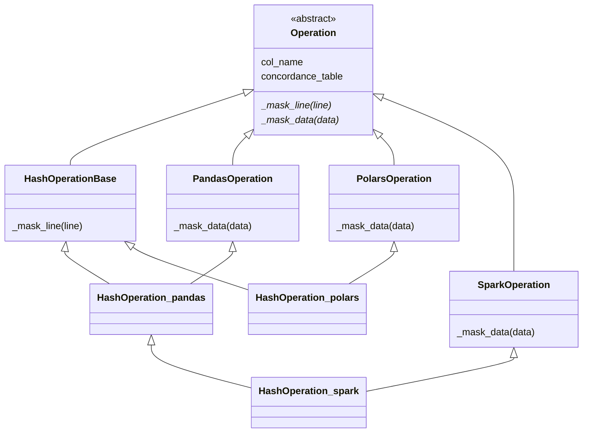
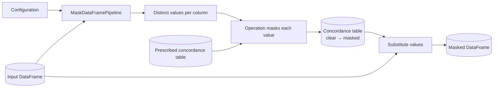

# Architecture

`masking` is a Python library: no services or deployed components. It separates *what* a masking operation does from *how* a DataFrame library applies it.

## Layers

| Layer      | Package                                                     | Contains                                                                                                                                       |
| ---------- | ----------------------------------------------------------- | ---------------------------------------------------------------------------------------------------------------------------------------------- |
| Operations | `masking.base_operations`                                   | `Operation` and one `*Base` class per operation, implementing `_mask_line` for a single value                                                  |
| Pipeline   | `masking.base_pipeline`, `masking.base_concordance_table`   | `MaskDataFramePipelineBase` and `ConcordanceTableBase`: configuration, chaining, concordance tables                                            |
| Backends   | `masking.mask`, `masking.mask_polars`, `masking.mask_spark` | A backend mixin (`PandasOperation`, `PolarsOperation`, `SparkOperation`), concrete operations, `ConcordanceTable`, and `MaskDataFramePipeline` |
| Fake data  | `masking.faker`                                             | `FakeNameProvider`, `FakeDateProvider`, `FakePLZProvider` and their bundled sources                                                            |
| Helpers    | `masking.utils`                                             | Hashing, Presidio analyzer setup, string matching, nested-dict traversal                                                                       |

Backends depend on the base layers; the base layers never import a backend.

## Operations

A concrete operation combines a backend-agnostic `*Base` class, which masks one value, with a backend mixin, which applies that to a column:

- Every operation follows this pattern; class names are identical across backends (`HashOperation` in `mask`, `mask_polars`, and `mask_spark`).
- Spark operations extend the pandas operation of the same name.
- Intermediate bases share behavior: `FakerOperation` (fake values, retries until the value differs from the input), `DictOperationBase` (JSON and dictionary traversal), and the `PresidioHandler`, `StringMatchHandler`, and `MultiNestedDictHandler` mixins from `masking.utils`.

## Pipeline Data Flow

1. The pipeline wraps each configured operation in a `ConcordanceTable` for its backend.
1. For each column, it collects the distinct values, masks each one once, and merges the result with any prescribed table.
1. It replaces the column's values through the concordance table and restores the input's column order.

Columns are independent: with `workers > 1` they are processed in parallel threads. See [Backends and pipelines](../available_modules.md) for the configuration format.

## Bundled Data

| File                                                            | Used by                 | Content                                           |
| --------------------------------------------------------------- | ----------------------- | ------------------------------------------------- |
| `faker/sources/firstnames2024.feather`, `lastnames2024.feather` | `FakeNameProvider`      | Swiss first and last names (BFS, 2024)            |
| `faker/sources/AMTOVZ_CSV_LV95.csv`                             | `FakePLZProvider`       | Swiss postal code directory (swisstopo)           |
| `base_operations/sources/med_stats_2024.xlsx`                   | `MedStatsOperationBase` | Postal code to MedStat region mapping (BFS, 2024) |
