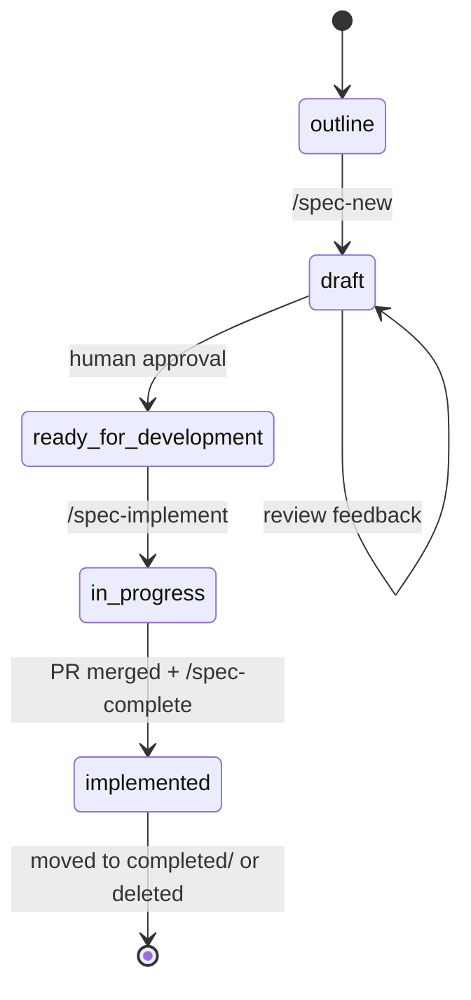

# Spec-Driven Development

Every non-trivial change starts from a spec. Specs define *what* and *how we know it works*; code defines *how*.

## When a Spec Is Required

See **Right-Sizing** in [specs/README.md](../../specs/README.md): no spec for refactors and typos, a short bugfix spec for bugs, a full spec for new features and interfaces.

## Cycle

| Step                | Who           | Prompt            | Output                                                        |
| ------------------- | ------------- | ----------------- | ------------------------------------------------------------- |
| 0. Grill (optional) | Agent + human | `/grill-me`       | Shared understanding of the idea before writing anything      |
| 1. Specify          | Agent + human | `/spec-new`       | `specs/backlog/<name>.md`, `status: draft`                    |
| 2. Approve          | Human         | —                 | `status: ready for development`                               |
| 3. Decide           | Agent + human | `/adr-new`        | `decisions/NNNN-*.md` (only if needed)                        |
| 4. Implement        | Agent         | `/spec-implement` | Tests + code, `status: in progress`, PR description           |
| 5. Review           | Human + CI    | —                 | Merged PR                                                     |
| 6. Complete         | Agent         | `/spec-complete`  | `status: implemented`, spec archived or deleted, docs updated |

Prompts live in [.github/prompts/](../../.github/prompts/). Other agents can follow the same files as plain instructions.

## Writing Good Specs

- One spec per independently shippable behavior; split large ones.
- Write what and why first; add design only once the behavior is agreed.
- Acceptance criteria are numbered (`AC1`, …), testable, and observable from outside the code.
- `out_of_scope` is explicit; agents treat it as a hard boundary.
- `assumptions` lists anything not verified against code, tickets, or ADRs.
- Unknowns are marked inline as `[NEEDS CLARIFICATION: …]`; any remaining marker or open question blocks approval.
- The **Spec Quality** checklist is complete before approval.

## Keeping Specs Honest

- If implementation diverges from the spec, update the spec in the same PR.
- Completed specs describe resulting behavior only; delete plans and progress notes.
- When behavior changes later, update or remove the completed spec.
